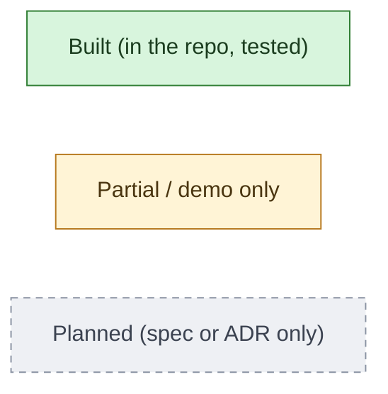

# Architecture Diagrams

Diagrams are written in [Mermaid](https://mermaid.js.org/) so they render on GitHub and
are reviewed in PRs like code. They describe the system as of engine 0.1.0 / importers 0.1.0
and the target design from the specs and ADRs.

| Document | What it shows |
|---|---|
| [System context & containers](./system-context.md) | Who uses the system, the deployable pieces (today and target), deployment |
| [Components](./components.md) | Monorepo packages and their dependencies; inside the tax engine, importers and rule packs |
| [Flows](./flows.md) | Import → match → calculate; the engine's year loop; valuation; fix queue; transfer matching; layered ledger; B2C journey; B2B API; Basis Passport; 1099-DA reconciliation |

## Legend

Every diagram uses the same convention for status:

Keep these diagrams in sync with the code: a PR that adds a package, changes a dependency
direction, or builds a planned component should update the matching diagram.
