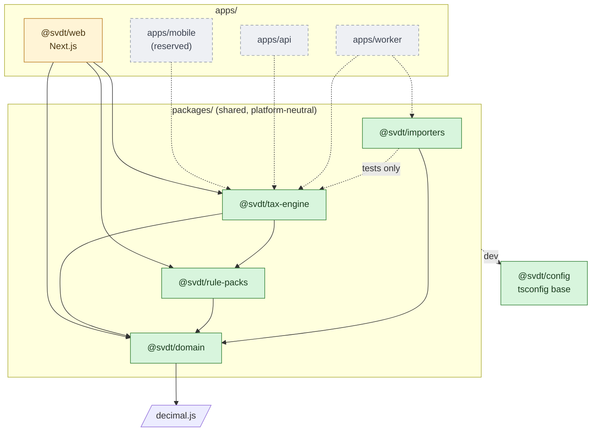
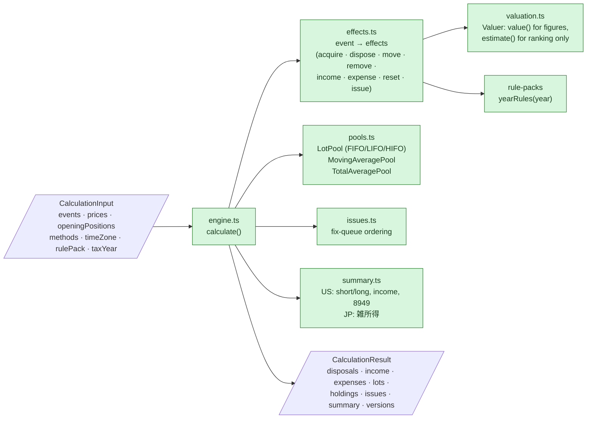
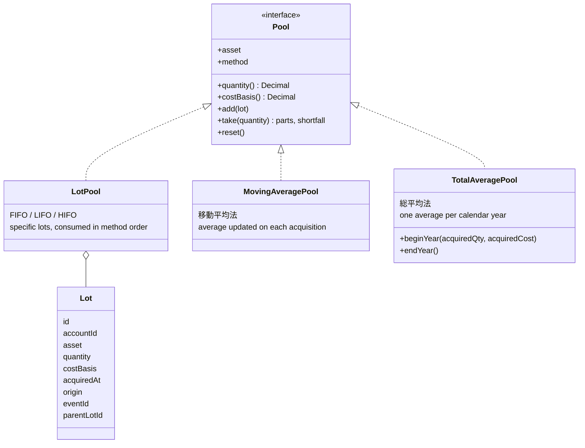
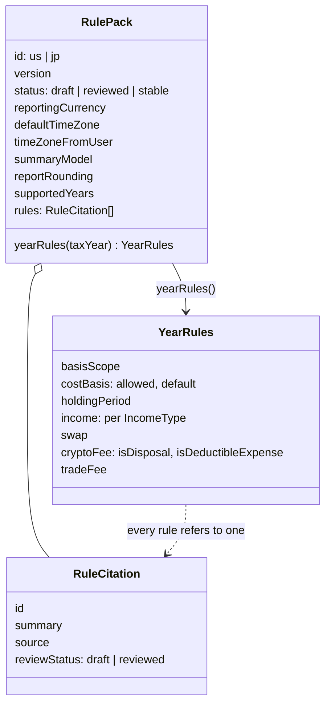

# Components

See the [legend](./README.md#legend). Related: [ADR-0002](../adr/0002-monorepo-structure.md),
[ADR-0006](../adr/0006-tax-engine-pure-library.md), [ADR-0007](../adr/0007-jurisdiction-rule-packs.md),
[ADR-0017](../adr/0017-importer-architecture.md).

## 1. Monorepo packages

Arrows point from a package to what it depends on. The rule from ADR-0002 holds: apps
depend on packages, never the reverse. The four shared packages are lint-guarded to stay
platform-neutral and deterministic (no Node/DOM APIs, no clock, no randomness).

| Package | Responsibility | Key exports |
|---|---|---|
| `@svdt/domain` | Ledger event types, decimal arithmetic, time zones | `LedgerEvent`, `Decimal`, `dec`, `allocateProportionally`, `localDate`, `parseInstant` |
| `@svdt/rule-packs` | Jurisdiction rules as cited data | `us`, `jp`, `RulePack`, `YearRules`, `UnsupportedTaxYearError` |
| `@svdt/tax-engine` | Pure, deterministic calculation | `calculate`, `CalculationResult`, `Disposal`, `Lot`, `Issue` |
| `@svdt/importers` | CSV parsing, format detection, transfer matching | `importCsv`, `matchTransfers`, `decodeText`, `csvImporters` |

## 2. Inside the tax engine

`calculate()` is the only entry point. Everything below it is pure.

### Pool model

Basis scope decides the pool key; the cost-basis method decides the pool type.

| Basis scope | Pool key | Used by |
|---|---|---|
| `per_account` | account + asset | US (Treas. Reg. §1.1012-1(j)) |
| `per_user` | asset | Japan (pooled across all exchanges) |

## 3. Rule packs

Rule packs are data; the engine implements the mechanisms (ADR-0007).

## 4. Importers

```mermaid
flowchart LR
  bytes[/"Uploaded file (bytes)"/]
  decode["text.ts<br/>decodeText<br/>UTF-8 → Shift_JIS fallback"]:::built
  csv["csv.ts<br/>RFC 4180 records<br/>header-row discovery"]:::built
  detect["index.ts<br/>importCsv: detect by<br/>required columns"]:::built
  subgraph formats["formats/"]
    canon["canonical<br/>(verified)"]:::built
    cb["coinbase<br/>(unverified)"]:::partial
    kr["kraken<br/>(unverified)"]:::partial
    jpstd["業界標準フォーマット<br/>(unverified)"]:::partial
    bf["bitFlyer<br/>(unverified)"]:::partial
  end
  values["values.ts / assets.ts<br/>amounts · timestamps · tickers · row ids"]:::built
  match["match-transfers.ts<br/>matchTransfers"]:::built
  out[/"LedgerEvent[] + warnings + stats"/]

  bytes --> decode --> csv --> detect --> formats
  formats --> values
  formats --> out
  out -- "all of a user's files" --> match

  classDef built fill:#d8f5dd,stroke:#2e7d32,color:#1b3d1f
  classDef partial fill:#fff4d6,stroke:#b7791f,color:#4a3510
```

"Unverified" importers are built from public descriptions and synthetic fixtures. They
need anonymized real exports before they're offered to users ([ADR-0017](../adr/0017-importer-architecture.md)).
