# Flows

See the [legend](./README.md#legend). Sections 1–6 describe code that exists today;
sections 7–11 describe planned flows from the specs and ADRs.

1. [Import → match → calculate](#1-import--match--calculate-built)
2. [The engine's year loop](#2-the-engines-year-loop-built)
3. [A disposal, step by step](#3-a-disposal-step-by-step-built)
4. [Valuation](#4-valuation-built)
5. [Fix-queue ordering](#5-fix-queue-ordering-built)
6. [Transfer matching](#6-transfer-matching-built)
7. [Layered ledger and recompute](#7-layered-ledger-and-recompute-planned)
8. [Consumer journey](#8-consumer-journey-planned)
9. [Partner Tax API and pre-trade preview](#9-partner-tax-api-and-pre-trade-preview-planned)
10. [Basis Passport](#10-basis-passport-planned)
11. [1099-DA reconciliation](#11-1099-da-reconciliation-planned)

---

## 1. Import → match → calculate (built)

How a user's exchange files become a tax result today (exercised end to end in
`packages/importers/test/pipeline.test.ts`).

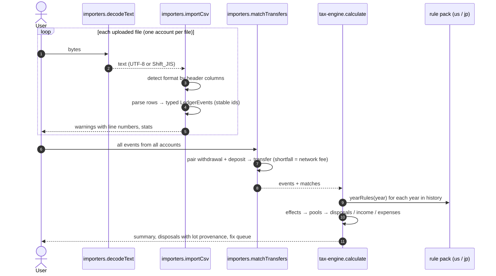

## 2. The engine's year loop (built)

`calculate()` processes the whole history up to the requested tax year, one calendar year
at a time in the rule pack's time zone. Total average (総平均法) needs each year's
acquisitions before any of that year's disposals, which is why effects are computed first.

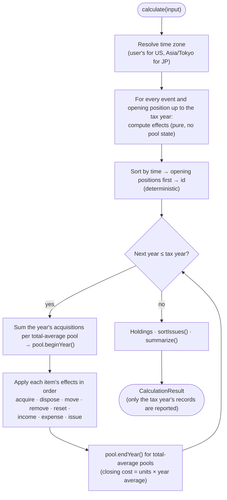

## 3. A disposal, step by step (built)

What happens when an effect disposes of units, e.g. selling 1.5 ETH.

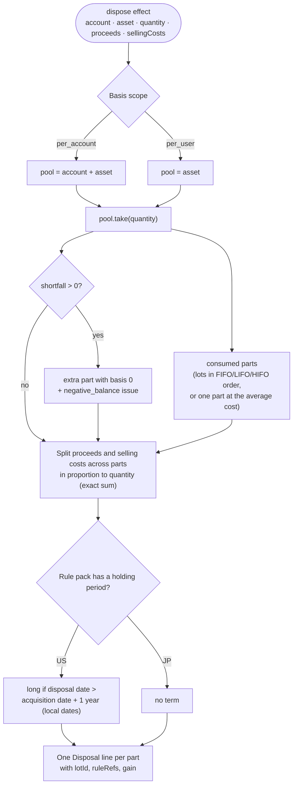

## 4. Valuation (built)

`Valuer.value()` decides the figures. `Valuer.estimate()` exists only to rank issues and
never feeds a reported figure.

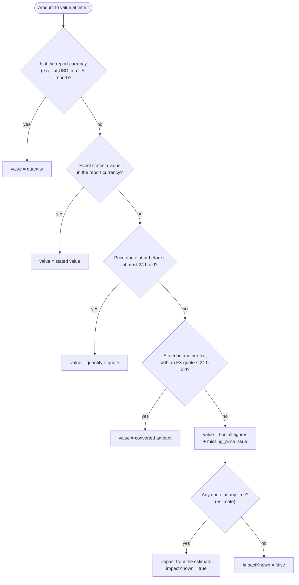

## 5. Fix-queue ordering (built)

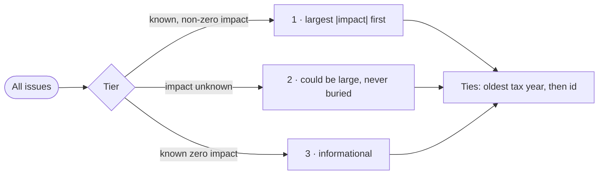

| Issue | Impact |
|---|---|
| `negative_balance` (sale) | −(proceeds of uncovered units); if proceeds were unpriced, the nearest-price estimate; else unknown |
| `negative_balance` (transfer) | market value, or nearest-price estimate, else unknown |
| `negative_balance` (send to unknown wallet) | unknown |
| `missing_basis` | −(market value on arrival, or nearest-price estimate), else unknown |
| `missing_price` | nearest-price estimate, else unknown |
| `unmatched_withdrawal` | + gain if it were a sale (market value or estimate), else unknown |
| `opening_position_mismatch` | unknown |
| `unsupported_history_year` | unknown (old activity processed with the earliest supported rules) |
| `method_not_allowed`, `opening_position_order`, `basis_currency_mismatch` | 0 (informational) |

## 6. Transfer matching (built)

For each withdrawal (in time order), choose the best deposit:

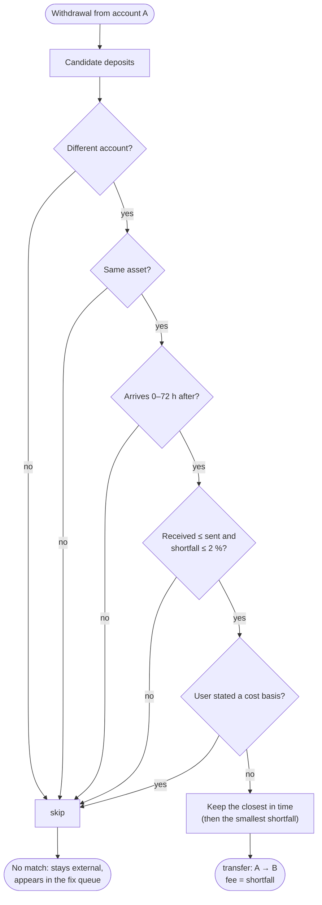

## 7. Layered ledger and recompute (planned)

From [ADR-0009](../adr/0009-layered-ledger.md). Derived results are never authoritative;
they're recomputed from the layers above them.

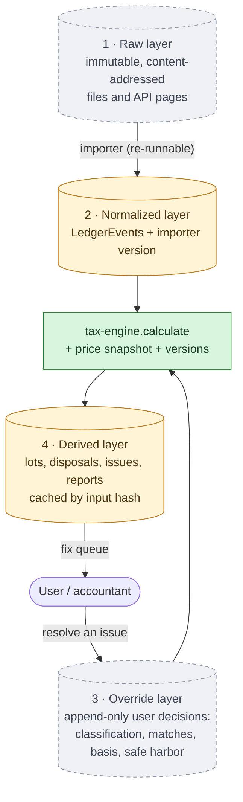

## 8. Consumer journey (planned)

From [product spec §4](../spec/product-spec.md).

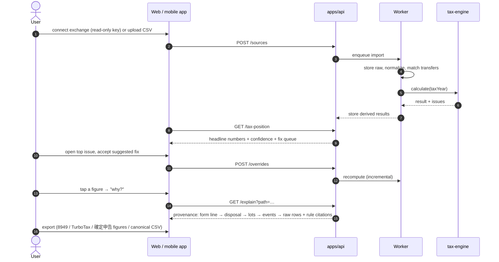

## 9. Partner Tax API and pre-trade preview (planned)

From the [B2B spec](../spec/b2b-platform-spec.md).

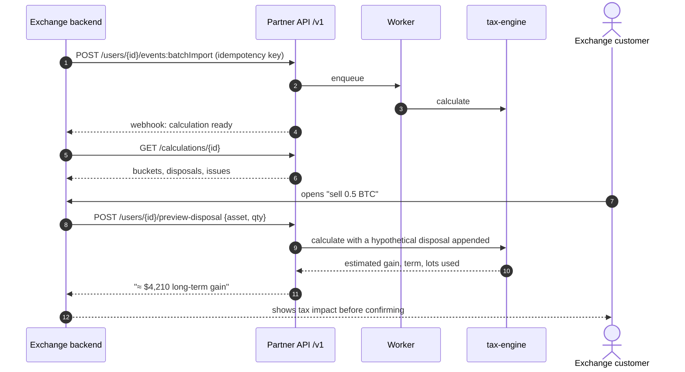

## 10. Basis Passport (planned)

From [gap analysis G4](../research/gap-analysis.md) and the [B2B spec §2.4](../spec/b2b-platform-spec.md).
It needs legal review before Phase 3.

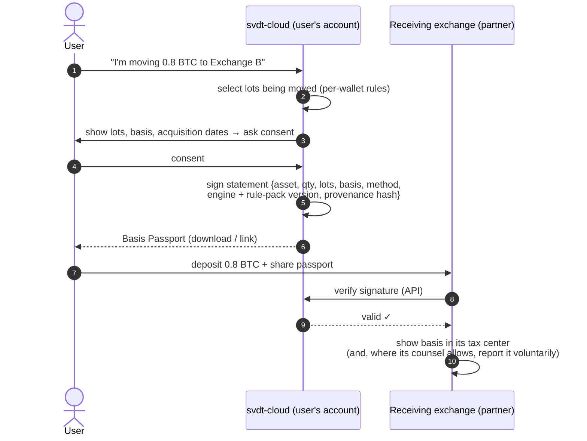

## 11. 1099-DA reconciliation (planned)

From [tax-engine spec §9](../spec/tax-engine-spec.md). Market status: incumbents now ship
this, so depth is the differentiator ([gap review](../research/gap-review-2026-10.md)).

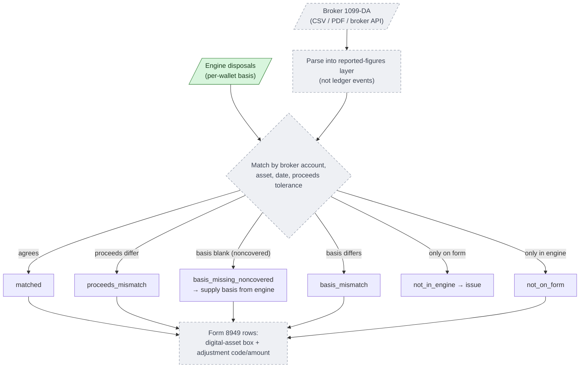
