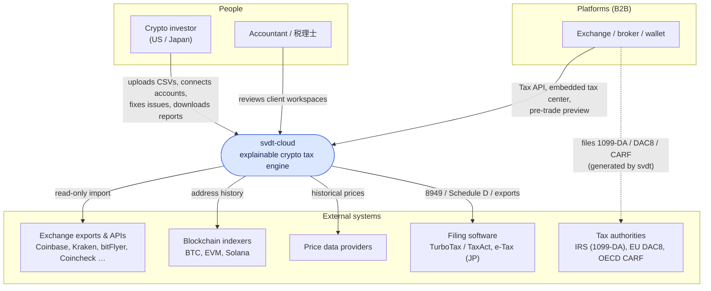
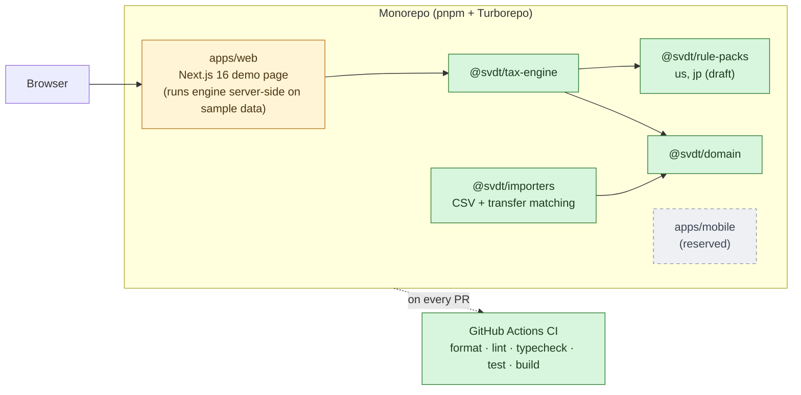
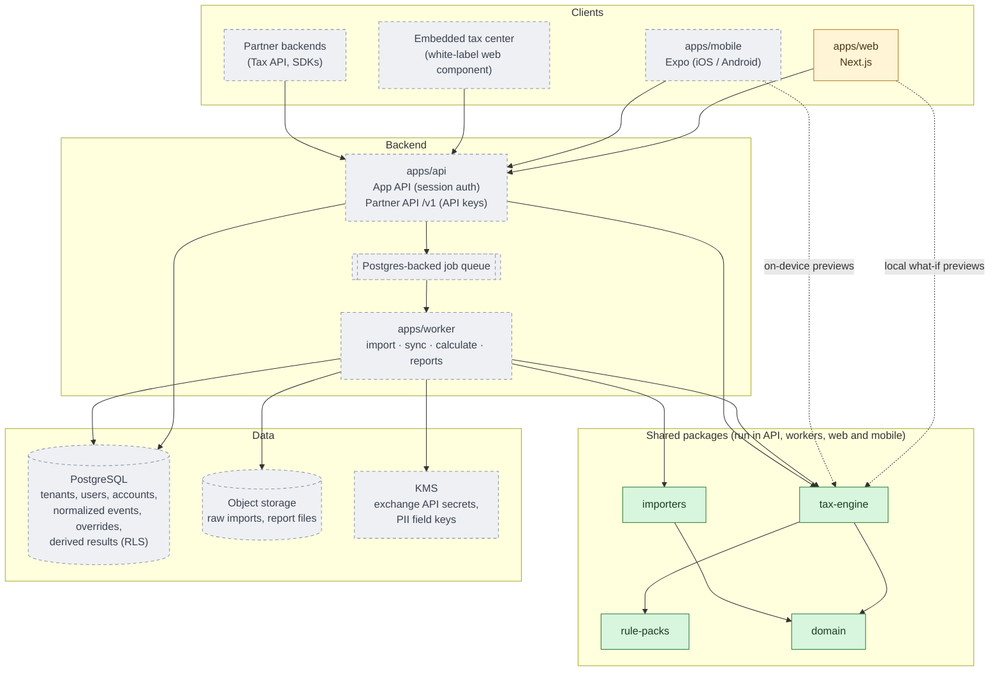
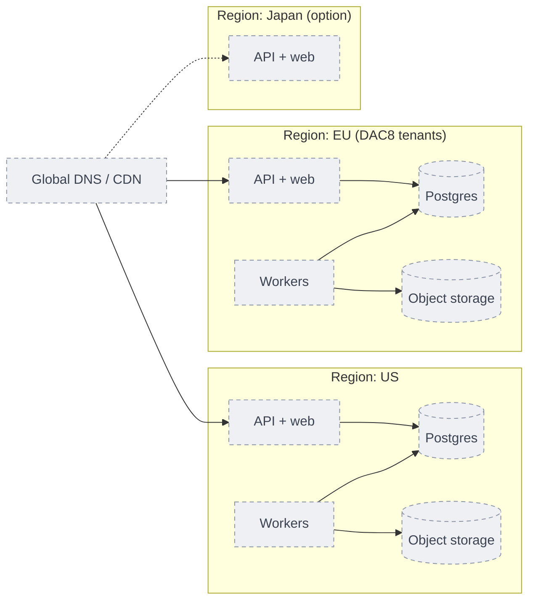

# System Context & Containers

See the [legend](./README.md#legend). Related: [ADR-0002](../adr/0002-monorepo-structure.md),
[ADR-0011](../adr/0011-api-first-multi-tenant.md), [B2B spec](../spec/b2b-platform-spec.md).

## 1. System context

Who and what svdt-cloud talks to.

## 2. Containers — today

What runs now. Everything is in one monorepo; nothing is deployed yet.

## 3. Containers — target

Every client goes through the same API (ADR-0011). The engine runs inside the API and
workers; mobile and web can also run it locally for instant previews (ADR-0003, ADR-0005).

## 4. Deployment — target

Data residency matters for DAC8 tenants ([security spec](../spec/security-privacy-spec.md)),
so each region is a self-contained stack.

Tenant data never crosses regions. Rule packs and engine versions are identical in every
region, so the same input gives the same output anywhere (ADR-0006).
