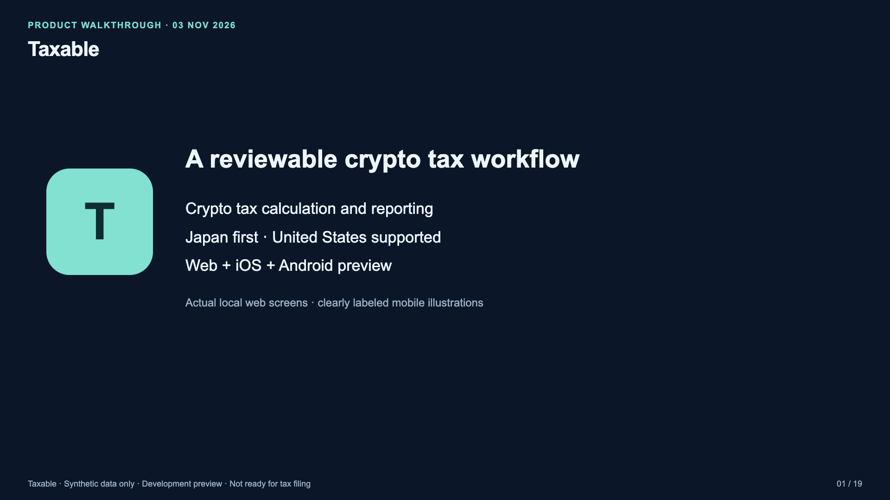

# Taxable — specifications, screens and user flow

**[Watch / download the MP4](taxable-walkthrough.mp4?raw=1)** ·
[English captions](captions.en.srt) · [Transcript](transcript.md) ·
[Playback verification](verification.json)

5 minutes 53 seconds · 1920×1080 · H.264/AAC · English synthetic narration · embedded subtitles.
Created 3 November 2026. All financial records are synthetic.

## Scope and honesty labels

- **Actual local web screens:** sign-in, overview, import, upload result, transactions,
  fix queue, manual cost-basis correction, correction history, draft report, report detail,
  settings and sign-out. Sign-in, upload, correction and logout were executed against a
  disposable in-memory local database. No production service was accessed for capture.
- **Illustrative mobile layouts:** sign-in, locked/retry state, Report, Transactions, Import,
  Corrections, manual correction and report detail. These are storyboard illustrations based
  on the implemented Expo UI, **not iOS/Android screenshots or verified device flows**.
  Native platform bundles passed, but native binaries and device UI testing remain outstanding.
- **Architecture and journey diagrams:** explanatory graphics, not deployment screenshots.
- **Planned/unverified:** identity-provider login/recovery, device management, native testing,
  security review, real exchange-export validation and professional tax-rule review.
- This depicts newer **uncommitted local implementation**, not the source tree of this
  documentation-only branch or a deployed release. [Source hashes](source-snapshot.json)
  identify the captured implementation without publishing unrelated work.
- Tax rules remain draft and exchange-specific importers remain unverified. This is not a
  filing-ready product or tax/legal advice. The visible web app uses its current `svdt` branding.
- The local Next.js command emitted a security-upgrade warning during capture. No dependency
  upgrade was performed for this video; that warning needs follow-up before release.

## Chapters

- **00:00** — Taxable
- **00:16** — One ledger. Three clients.
- **00:36** — 01 · Sign in
- **00:51** — 02 · Review the overview
- **01:10** — 03 · Import a CSV
- **01:29** — 04 · Inspect the import result
- **01:46** — 05 · Check transactions
- **02:02** — 06 · Review the fix queue
- **02:20** — 07 · Supply a correction
- **02:36** — 08 · Recalculate and keep history
- **02:52** — 09 · Review the draft report
- **03:09** — 10 · Inspect how basis was used
- **03:28** — 11 · Choose settings
- **03:49** — 12 · Sign out
- **04:05** — Mobile · Access and recovery
- **04:24** — Mobile · Four working areas
- **04:46** — Mobile · Correct and investigate
- **05:09** — The complete preview journey
- **05:30** — What remains before release

## Verification and publication

The complete MP4 decoded with FFmpeg without errors. Chrome played it and successfully sought
to its midpoint and near its end; metadata confirms 1080p video, audio and captions. Representative
frames were visually inspected. The narration track was checked for non-silent audio.

This branch publishes documentation assets only, plus branch-specific Vercel deployment guards
in the repository and both app roots. The guards disable automatic deployments for this video
branch only, using [Vercel's documented Git configuration](https://vercel.com/docs/project-configuration/git-configuration).
No merge, app deployment, remote migration, credential provisioning or account creation was requested.
Application implementation changes and pre-existing HANDOFF.md edits remain in the original checkout.

If GitHub does not display an inline video preview, use the Watch / download link above.
